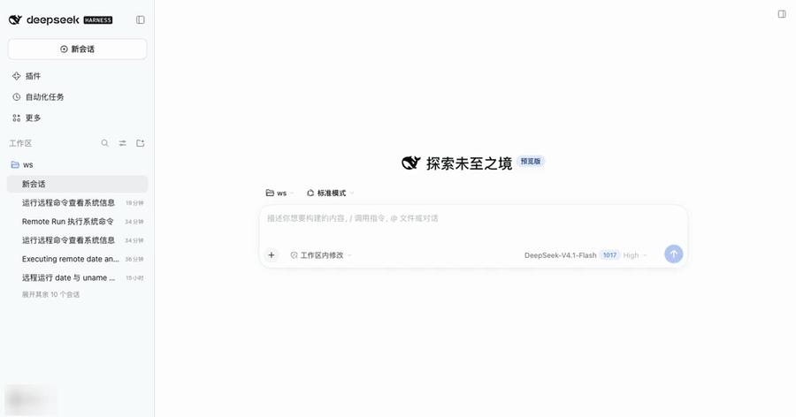
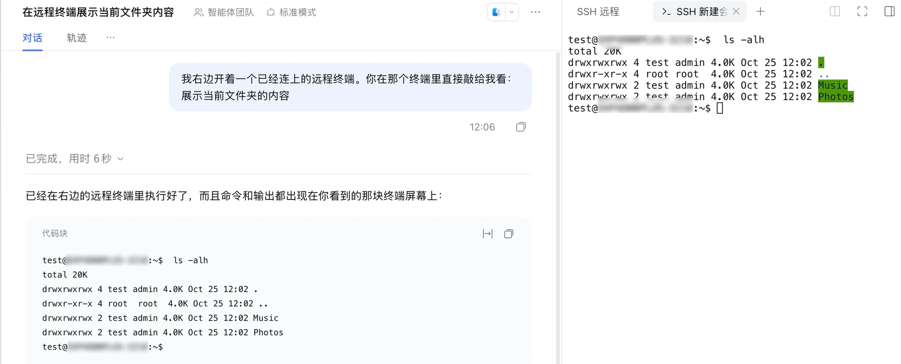
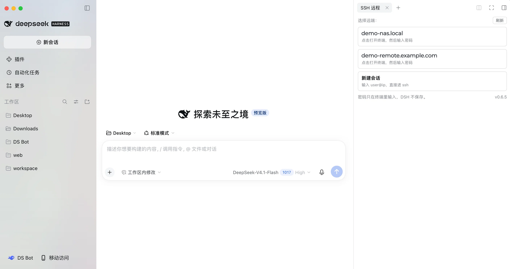
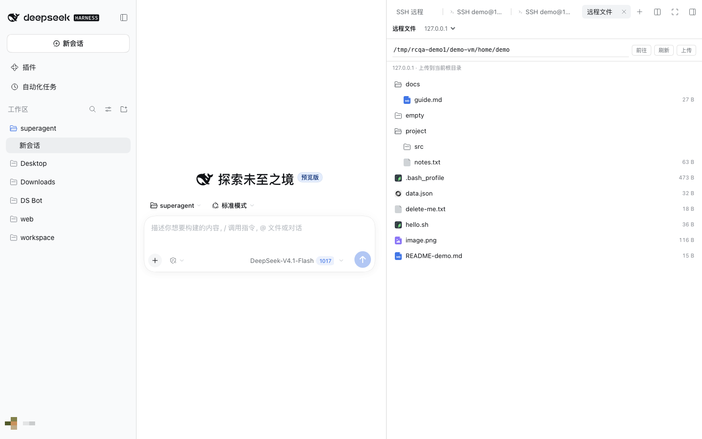

# dsh-remote-console

**An SSH terminal in DSH's right sidebar — you and your agent share one window.**

[](https://github.com/deepseek-ai/deepseek-harness)

[中文](https://github.com/cccodder/dsh-remote-console/blob/main/README.md) | English


You ssh in, type your password, and the agent can only wait — it cannot see your terminal. This plugin puts the agent **in the terminal you are watching**: you see the commands it types, you can take over at any moment, and both sides land in the same log.

No DSH source changes, no terminal rewrite, no touching or storing your password.



*Pick a host → type the password → the agent runs `date && uname -a` in the same terminal → you take over with `cd /tmp` → the agent runs `pwd`, still `/tmp`. The example host is a throwaway test sshd.*

## What's different

Most SSH plugins give the agent its **own exec channel**: you cannot see what it runs, it does not know what you typed, `cd` / `export` state is lost between calls, and interactions that only a human can do — passwords, sudo, host-key prompts — have nowhere to happen.

Here there is one channel.

1. You pick a host in the sidebar and type the password yourself — the connection belongs to your session.
2. When the agent runs a command, the characters appear in **that** terminal; the output it reads is **that** screen buffer.
3. You can take over at any point; the agent's next call sees the state after your keystrokes (`cwd`, environment included).
4. Every command from either side goes into **one audit trail**: who, when, what, and the exit code.

The trade-off, stated plainly: one terminal per session, no second pane; rendering, input and scrolling are all DSH's own terminal.



*Left: the agent's `remote_run` in chat. Right: output in the same PTY. `pwd` is `/tmp` on both sides.*

## Highlights

- **One shared screen**: the agent's commands run in your terminal — visible, take-over-able; exit codes come from a remote `PROMPT_COMMAND` hook (OSC), not from guessing a prompt.
- **Traceable end to end**: a cross-session audit of commands, exit codes, approvals, transfer sha256s and tunnels, grouped into a per-session timeline. No screen content, redacted before write.
- **A panel that does things**: pinned, connected and recent hosts stay in front while other groups fold away; each row offers direct Connect / Files actions. The remote-files tab names the host and its connection state, with breadcrumbs, a native-style tree and text editor; uploads follow the current directory, with download and delete alongside.
- **Authenticate once, reuse everywhere**: file transfer and three-way port forwarding (`-L` local-to-remote / `-D` local SOCKS5 / `-R` remote-to-local) all ride the authenticated ControlMaster socket — no second password prompt, and everything fails closed when the terminal ends.
- **Dangerous operations get a human**: `rm -rf`, `mkfs`, `git push --force` and friends trigger an approval that says *why*; one grant covers one command, and a deployment without an approval service refuses outright. Credentials never land in a log.
- **One terminal per session**: tools verify console ownership, so another session cannot read your screen or run commands in your terminal.





https://raw.githubusercontent.com/cccodder/dsh-remote-console/main/docs/images/remote-files-demo.mp4

*50 seconds of remote files: expanding directories, editing and saving in a dedicated page, switching consoles and uploading. From a real signed-in acceptance recording, masked.*

## Get started in 30 seconds

Plugin market (recommended): sidebar "Discover" → "Add index source" → paste
`https://cccodder.github.io/dsh-remote-console/market/index.json` → install → "Enable now".

A CLI-managed profile:

```bash
dsh plugin --profile web add dsh-remote-console
# then add "dsh-remote-console" to that profile's dsh.profile.bundles and restart DSH
```

On the desktop app, use the in-app plugin manager and search for `dsh-remote-console`. Then: right sidebar "SSH Remote" → pick a host → type the password yourself → let the agent work in the same terminal.

## What it is not

| What you might want | The answer here |
| --- | --- |
| A remote dev environment (file tree, workspace mirror, VS Code Remote) | No. You get a real remote terminal; large files go through `remote_upload` / `remote_download` |
| An agent silently connecting to a host in the background | No. It runs in the terminal you are watching — visible, take-over-able, audited |
| A new terminal that reimplements rendering | No. xterm rendering, input and windowing are all DSH's own |
| A patched DSH | No. It only wraps terminal services; DSH upgrades need no re-patching |

If this saves you a few window switches, give it a [⭐ Star](https://github.com/cccodder/dsh-remote-console) so more people in DSH can find it.

## Documentation

- [Usage guide](docs/usage.md) — three install paths, the 18 agent tools, choosing a channel, host lists, updates, environment variables, data directory
- [Security model and permissions](docs/security-model.md) — credentials, session isolation, approvals, transfers, audit, and the full exposure list
- [Troubleshooting and performance](docs/troubleshooting.md) — common errors, Control socket, update issues, loopback baseline
- [Compatibility and capability matrix](docs/compat.md) — DSH / platforms / tools / Windows support (zh and en)
- [Audit design](docs/AUDIT.md) · [Verification checklist](docs/verify-e2e.md) · [Release checklist](docs/dev/release-checklist.md)
- Security reports: [SECURITY.md](SECURITY.md) · Contributing: [CONTRIBUTING.md](CONTRIBUTING.md)

## License

MIT · [LICENSE](LICENSE)

[](https://github.com/deepseek-ai/deepseek-harness)
