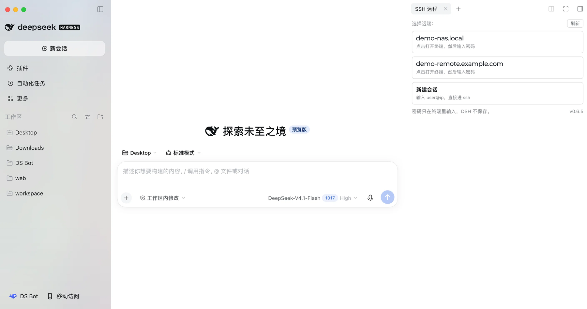
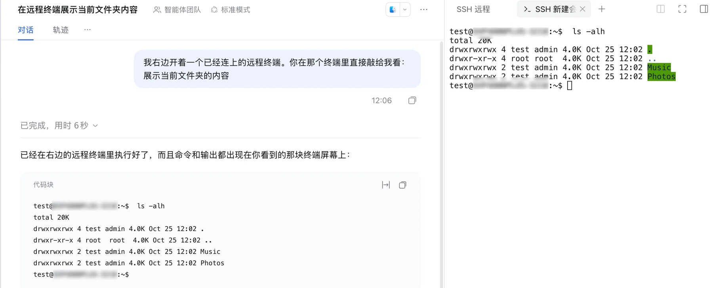

# dsh-remote-console

[中文](README.md) | English


An SSH remote console in the DeepSeek Harness (DSH) right sidebar: you and your agent work on
the remote host through the **same PTY**. You complete the SSH login yourself; the agent runs
commands through that same terminal; both sides write to one replayable activity log.

The plugin does not reimplement a terminal: rendering, input and window management reuse
DSH's own terminal. It only adds remote launchers to the shell list, captures that PTY's
byte stream, and gives the agent tools that write into the same terminal.





## Why

Agent remote execution is usually a second, invisible SSH channel: you cannot see what it
types, nobody can answer the password/sudo/host-key prompts, and shell state (`cd`,
`export`) is lost between calls.

This plugin puts the agent inside **the terminal you are already watching**. Its commands
appear in the window like human typing, and the exit code comes from the shell's own
`PROMPT_COMMAND` hook (an OSC marker), not from guessing at prompts.

## Install

Requires DSH `>= 0.2.1-rc.2 <0.3.0` and a system `ssh` client.

**npm package**: `dsh-remote-console` (https://www.npmjs.com/package/dsh-remote-console).

**Plugin market (recommended — gives a real Update entry)**: a DSH plugin market index
(format 1) is published with the repository:

```
https://cccodder.github.io/dsh-remote-console/market/index.json
```

Add it under **Discover → Add index source**, then install from the list. When a newer
version is published the entry shows "Update available" and DSH handles the update through
the plugin manager.

**CLI-managed profile** (e.g. `web`):

```bash
# 1. install into a profile (replace "web" with your profile name)
dsh plugin --profile web add dsh-remote-console

# 2. add it to that profile's bundle list
#    $DSH_HOME/profiles/web/package.json:
#      "dsh": { "profile": { "bundles": [ ..., "dsh-remote-console" ] } }

# 3. confirm the layer is composed (expect: id: dsh-remote-console)
dsh --profile web --dump-config | grep -A2 dsh-remote-console
```

**Electron desktop app**: the `desktop` profile is owned by the app and the CLI refuses it
(`profile "desktop" is managed exclusively by the Electron application`). Install through the
in-app plugin manager: package name `dsh-remote-console` (npm), or the repository address
`github:cccodder/dsh-remote-console` (latest commit). It writes `dependencies` and
`dsh.profile.bundles` for you. The global `dsh` CLI may be older than the DSH bundled in the
app — the app's version is the one that counts.

No Python, no edits to `~/.ssh/config`, no shell rc changes.

## Usage

1. Right sidebar → the "SSH 远程" guide card → pick a host (from `~/.ssh/config`, or add one).
2. The terminal runs `ssh -M -S <sock> -t <host>`; `ssh` prompts for the password itself —
   the plugin never sees it.
3. Agent tools after login:

| Tool | Purpose |
| --- | --- |
| `remote_status` | Console, host, socket, state, last screen lines |
| `remote_run(command)` | Write into the same PTY (visible in the window), return output + real exit code (the PTY merges stderr into it) |
| `remote_exec(command, cwd?)` | Out-of-band execution over the ControlMaster socket: native stdout/stderr/exit code, no terminal noise |
| `remote_screen(lines)` | Current screen as plain text (ANSI stripped) |
| `remote_log(cursor)` | Incremental read of the unified JSONL log (human commands, agent commands, both outputs) |
| `remote_close()` | Close the ssh master and clean up socket/rendezvous files |

**`exit` semantics**: host launchers and "new session" are one-shot — when the remote shell
exits (`exit`/`logout` in a command, or ssh drops), the whole console ends, every `remote_*`
tool stops working, and a human must reopen the terminal and log in again. Such commands ask
for approval first, and the terminal says plainly that it has ended instead of pretending
the session is still usable.

## Updates

**Noticing a new version**: the panel footer shows the running version (e.g. `v0.6.5`). The
client asks GitHub for the latest release once (cached for 6 hours; offline/rate-limit/CORS
failures are silent) and shows "有新版本 vX.Y.Z" next to it when a newer release exists; the
link opens the GitHub release page.

**Option 1 — plugin market (real Update entry)**

The plugin is published to npm with a format-1 market index:

```
https://cccodder.github.io/dsh-remote-console/market/index.json
```

Add it under **Discover → Add index source**; the entry then shows "Update available" when a
newer version is in the index, and DSH installs it through the plugin manager (`dsh-remote-console@<version>`
from npm). The install location and the data directory stay the same.

> This is GitHub Pages, updated on every push (the first build takes about a minute).
> If it is unreachable, use the jsDelivr URL
> `https://cdn.jsdelivr.net/gh/cccodder/dsh-remote-console@main/market/index.json`
> (branch cache up to ~12h), the raw GitHub URL, or host `market/index.json` on your own
> static server — it is just a JSON document.

**Option 2 — manual reinstall (no market enabled)**

1. Sidebar → **Plugins** → installed plugins → `dsh-remote-console` → **Uninstall** (confirmed).
2. **Add plugin** → `dsh-remote-console` (npm) or `github:cccodder/dsh-remote-console`
   (latest commit) → install → **Enable now**.
3. Restart the DSH desktop app once. The plugin re-runs `apply()` on hot reload and the wrap is
   idempotent now, but a restart is the clean path (stale wraps from 0.6.0/0.6.1 need it).

Hosts and `hosts.tsv` live in `~/.dsh/remote-console/`, outside the package, so uninstalling
does not lose them.

**About one-click updates**: the plugin manager only offers *Update* for official on-demand
plugins. Third-party plugins get the same experience by shipping a plugin market index
(`market/index.json` in this repository) or being published to npm for the manager to install.

## Security

- **Credentials never pass through the plugin**: the password is typed into `ssh`'s own
  prompt. `hosts.tsv` stores only host/user/port (mode 0600), the data dir is 0700, and no
  key material is ever written.
- **No writes during authentication**: while the screen sits on `password:`, `(yes/no)?`,
  `Permission denied`, etc., agent writes are rejected (`AUTH_REQUIRED`).
- **Dangerous-command approval**: `remote_run`/`remote_exec` bypass the DSH sandbox, so the
  plugin adds a gate: patterns such as `rm -rf`, `mkfs`, `dd of=/dev/*`,
  `shutdown/reboot`, fork bombs, `curl | sh`, `git push --force`, `DROP TABLE` trigger a
  one-shot approval card through DSH's `ctx.approval`. A grant covers that command only;
  with no approval service mounted the command fails closed. `exit`/`logout`/`pkill ssh` in
  `remote_run` (which end the whole console) ask for approval too.
- **Logs disappear**: the per-session JSONL is deleted when the PTY ends; logs left behind
  by a DSH crash are swept on the next plugin start. Known secret shapes (Bearer tokens,
  `sk-*`, `password=/token=/secret=`) are redacted, but plaintext secrets inside command
  arguments can still appear during the session — prefer env vars or `ssh-agent`.
- **Closing means revoking**: closing the terminal tab kills the process tree immediately;
  closing the browser kills it 8 s after the last window hold disappears (a refresh
  reconnects and cancels); if DSH crashes, the PTY master disappears and `ssh` exits on HUP.

## Reporting a vulnerability

Please report privately through GitHub Security Advisories, not in a public issue. The full
policy (supported versions, what the plugin promises, known limitations) is in [SECURITY.md](SECURITY.md).

## Environment variables

| Variable | Default | Meaning |
| --- | --- | --- |
| `DSH_REMOTE_CONSOLE_DIR` | `$DSH_HOME/remote-console` | Data dir (logs/sessions/socks/bin) |
| `DSH_SSH_CONFIG` | `~/.ssh/config` | Host alias source |
| `DSH_RC_DANGER_GUARD` | `approve` | `off` disables the approval gate (still audited) |
| `DSH_RC_DRYRUN` | `0` | Wrapper dry-run: print the ssh command without running it |
| `DSH_RC_NO_CLEAR` | `0` | `1` disables the automatic screen clear |
| `DSH_RC_SELFTEST` | `0` | Run the built-in self test once at startup |

## Compatibility

- The plugin wraps DSH's terminal services (`ctx.subprocess.spawnTerminal`,
  `ctx.terminalController.shells|retain`, client `ctx.webTerminals.launchShells`). This is
  the common community-plugin approach but **not a documented extension point**; DSH
  changes to those internals need a matching update (`engines.dsh` declares the tested range).
- Remote shells start as `bash -li` to install the `PROMPT_COMMAND` hook. Without bash the
  plugin falls back to sentinel framing — same capability, slightly noisier screen.
- No full terminal emulation: in-line overwrite is simplified, so `remote_screen` can
  differ from the real screen in extreme TUI cases; trust `remote_run`/`remote_exec` for results.

## Development

```bash
npm test        # 69 tests + release metadata checks
npm run verify  # version / client VERSION / changelog / market index consistency only
```

Tests need neither `ssh` nor a real PTY: `tests/link-peers.mjs` links the peer packages from
your global DSH install (CI installs them with `npm install --no-save`), and
`tests/console.test.mjs` replays OSC frames from a fake remote shell.

- Development rules and branch model: [CONTRIBUTING.md](CONTRIBUTING.md)
- Agent rules: [AGENTS.md](AGENTS.md)
- Manual end-to-end verification: [docs/verify-e2e.md](docs/verify-e2e.md)
- Real-device release checklist: [docs/dev/release-checklist.md](docs/dev/release-checklist.md)
- Release process: bump version + CHANGELOG + `npm run market:index` in a release PR, merge,
  then publish the `vX.Y.Z` GitHub release; the workflow validates the tag, runs the tests,
  publishes to npm with provenance and attaches the `.tgz` to the release.

## License

MIT. See [LICENSE](LICENSE).

[](https://github.com/deepseek-ai/deepseek-harness)
