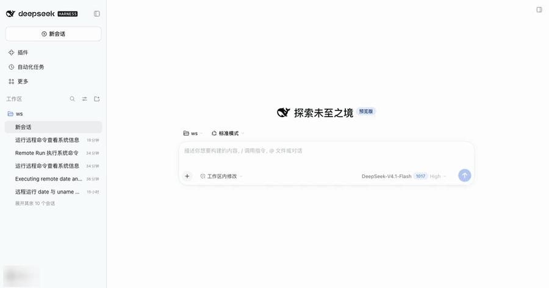
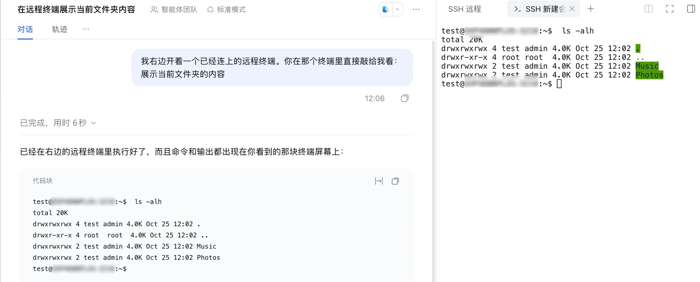
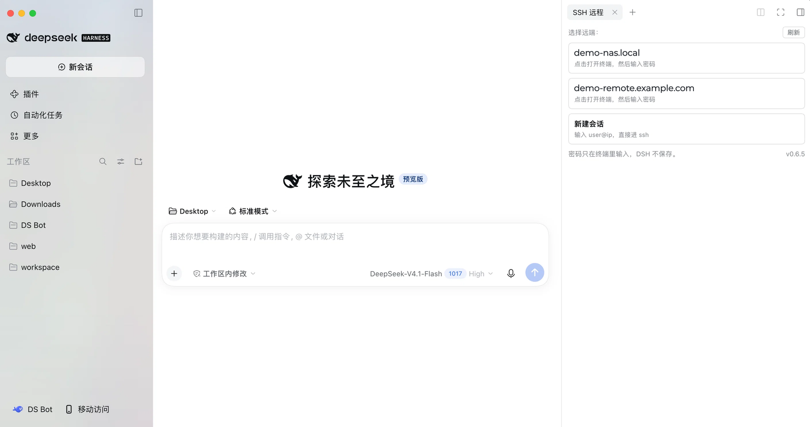

# dsh-remote-console

**DSH 右侧栏的 SSH 终端——你和 agent 共用一个窗口。**

[](https://github.com/deepseek-ai/deepseek-harness)

中文 | [English](https://github.com/cccodder/dsh-remote-console/blob/main/README.en.md)


你 ssh 上去、输完密码，agent 只能在旁边等着——它看不见你的终端。这个插件把 agent 放进**你正在看的那个终端**：它敲的命令你看得见，你随时能接手，双方的操作都落在同一条日志里。

不改 DSH 源码、不重写终端、不碰也不存你的密码。



*选主机 → 输密码 → agent 在同一个终端跑 `date && uname -a` → 人接手 `cd /tmp` → agent 跑 `pwd` 仍是 `/tmp`。示例主机是测试用的假 sshd。*

## 为什么不一样

多数 SSH 插件让 agent 走**自己的一条 exec 通道**：它跑的命令你看不见，你敲的命令它不知道，`cd` / `export` 这类 shell 状态在两次调用之间丢失，密码、sudo、主机指纹这些必须人来的交互也没有地方做。

这里只有一条通道。

1. 你在侧栏选主机、亲手输密码——连接属于你的会话。
2. agent 执行命令时，字一个一个出现在**这个**终端里；它读到的输出，就是**这块**屏幕缓冲。
3. 你随时接手敲命令；agent 下一次调用读到的是你操作之后的现场（`cwd`、环境变量都在）。
4. 双方每条命令进**同一条审计**：谁、什么时候、跑了什么、退出码多少。

代价也说清楚：一次会话一个终端，不开第二块；渲染、输入、滚动全部复用 DSH 自带终端。



*左边是聊天里 agent 的 `remote_run`，右边是同一个 PTY 的输出；`pwd` 两边都是 `/tmp`。*

## 亮点

- **人机同屏**：agent 的命令在你的终端里执行，看得见、能接手；退出码由远端 shell 的 `PROMPT_COMMAND` 钩子回报，不靠猜提示符。
- **全程可追溯**：跨会话审计记命令、退出码、审批、传输 sha256、端口转发；按会话聚合成时间线，一眼看清「这段时间在这台机器上做了什么」。不含屏幕内容，命令写入前脱敏。
- **面板能干活**：主机列表带搜索、最近连接、分组置顶、跳板链路；状态行显示终端/隧道/24h 命令；独立「远程文件」页提供原生风格文件树与文本编辑，支持上传、下载、删除。
- **一次认证，处处复用**：文件传输与三向端口转发（`-L` 本地转到远端 / `-D` 本地 SOCKS5 / `-R` 远端转到本地）都走已认证的 ControlMaster socket，不弹第二次密码；终端一结束立即失效。
- **危险操作有人把关**：`rm -rf`、`mkfs`、`git push --force` 等命中时弹审批，说清「为什么危险」；一次授权只对本次命令有效，无审批服务时直接拒绝。凭据不落盘、不进日志。
- **一次会话一个终端**：终端按会话归属校验，别的会话读不到你的屏幕、不能在你的终端里执行。



## 30 秒上手

插件市场（推荐）：侧栏「发现」→「添加索引源」→ 粘贴
`https://cccodder.github.io/dsh-remote-console/market/index.json` → 安装 →「立即启用」。

CLI 管理的 profile：

```bash
dsh plugin --profile web add dsh-remote-console
# 再把 "dsh-remote-console" 加进该 profile 的 dsh.profile.bundles，重启 DSH
```

桌面版用 App 内的插件管理器搜 `dsh-remote-console`。装好后：右侧栏「SSH 远程」→ 选主机 →
自己输密码 → 让 agent 在同一个终端里干活。

## 它不是什么

| 你可能想要的 | 本插件的答案 |
| --- | --- |
| 远程开发环境（文件树、工作区镜像、VS Code Remote 那套） | 不是。给你一个真实的远端终端；大文件走 `remote_upload` / `remote_download` |
| 让 agent 背着你在后台连机器跑命令 | 不是。它就在你盯着的终端里跑，看得见、可接手、有审计 |
| 自己渲染终端的新终端 | 不是。xterm 渲染、输入、窗口全部复用 DSH 自带 |
| 打了 DSH 补丁才能用 | 不是。只包装终端服务，DSH 升级不用重新打补丁 |

如果这个插件帮你少切了几次窗口，给个 [⭐ Star](https://github.com/cccodder/dsh-remote-console) 支持一下——这能让更多在 DSH 里连远程的人找到它。

## 文档

- [使用指南](docs/usage.md) — 安装三种方式、18 个 agent 工具、怎么选通道、主机列表、更新、环境变量、数据目录
- [安全模型与权限](docs/security-model.md) — 凭据、会话隔离、审批、传输、审计的完整说明与暴露面清单
- [故障排查与性能](docs/troubleshooting.md) — 常见报错、Control socket、更新问题、loopback 性能基线
- [兼容性与能力矩阵](docs/compat.md) — DSH / 平台 / 工具 / Windows 支持范围（中英）
- [审计设计](docs/AUDIT.md) · [验证清单](docs/verify-e2e.md) · [发布清单](docs/dev/release-checklist.md)
- 安全报告：[SECURITY.md](SECURITY.md) · 贡献：[CONTRIBUTING.md](CONTRIBUTING.md)（[中文](CONTRIBUTING.zh.md)）

## 许可

MIT · [LICENSE](LICENSE)

[](https://github.com/deepseek-ai/deepseek-harness)
