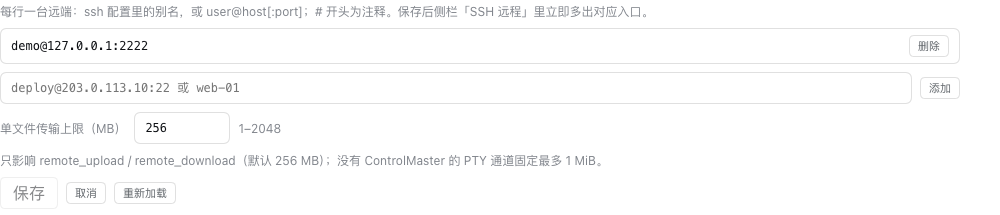

# 使用指南

安装、日常用法、主机列表维护、更新、环境变量与数据目录。
产品定位与「人机同屏」的概念见 [README](../README.md)，平台/能力矩阵见 [compat.md](compat.md)。

## 安装

要求：DSH `>= 0.2.1-rc.2 <0.3.0-0`，本机有系统 `ssh` 客户端。不需要 Python，不需要改
`~/.ssh/config`，不改 shell rc。npm 包名 `dsh-remote-console`。

**插件市场（推荐，能显示「有新版本」）**：侧栏「发现」（需启用实验性 bundle
`@deepseek-ai/dsh-experimental-plugin-market-bundle`）→「添加索引源」→ 粘贴：

```
https://cccodder.github.io/dsh-remote-console/market/index.json
```

这是 GitHub Pages 镜像，每次推送后自动更新（首次启用约需 1 分钟）。不通时换
`https://cdn.jsdelivr.net/gh/cccodder/dsh-remote-console@main/market/index.json`（分支缓存最长约 12 小时）
或 `https://raw.githubusercontent.com/cccodder/dsh-remote-console/main/market/index.json`；
也可以把仓库里的 `market/index.json` 放到自己的静态服务器上。

**CLI 管理的 profile**（例如 `web`）：

```bash
# 1. 装进 profile（--profile 换成你自己的 profile 名）
dsh plugin --profile web add dsh-remote-console

# 2. 把插件加进该 profile 的 bundle 列表
#    编辑 $DSH_HOME/profiles/web/package.json：
#      "dsh": { "profile": { "bundles": [ ..., "dsh-remote-console" ] } }

# 3. 确认插件层被组合进来（应看到 id: dsh-remote-console）
dsh --profile web --dump-config | grep -A2 dsh-remote-console
```

**Electron 桌面版**：`desktop` profile 由 App 独占管理，CLI 会直接拒绝
（`profile "desktop" is managed exclusively by the Electron application`）。
请用 App 内置的**插件管理器**安装：包名填 `dsh-remote-console`（npm），或粘贴
`github:cccodder/dsh-remote-console`（git 最新提交）。它会自动写入 profile 的
`dependencies` 与 `dsh.profile.bundles`。注意全局 `dsh` CLI 版本可能低于 App 自带的 DSH，
以 App 内的版本为准。

首次从市场安装的第三方插件，DSH 会先记成**停用**状态：装完要在插件页点「立即启用」
（或打开开关）才会真正生效，之后侧栏才出现「SSH 远程」入口。

## 用法

1. 右侧栏 →「SSH 远程」卡片 → 选中一个远端（来自 `~/.ssh/config` 的 Host，或手动新建）。
2. 终端里执行 `ssh -M -S <sock> -t <host>`，密码/口令由 `ssh` 自己提示，**插件不接触**。
3. 登录成功后，agent 可用下列工具。

### agent 工具（18 个）

| 工具 | 作用 |
| --- | --- |
| `remote_status` | 终端、主机、socket、状态、最后几行屏幕；顶部给出通道摘要与选路提示 |
| `remote_run(command)` | 写进同一个 PTY（窗口里可见），返回输出 + 真实退出码（PTY 把 stderr 并进输出） |
| `remote_exec(command, cwd?)` | 复用 ControlMaster socket 的带外执行：原生 stdout/stderr/退出码，不污染终端窗口 |
| `remote_upload(local_path, remote_path, overwrite?)` | 本地 → 远端，流式传输并双向校验 sha256，默认不覆盖；单文件默认 256 MB（设置页可调 1–2048 MB） |
| `remote_download(remote_path, local_path, overwrite?)` | 远端 → 本地，流式传输并校验 sha256，默认不覆盖本地文件；上限同上 |
| `remote_read_file(path, max_bytes?)` | 读远端文本（默认 128 KB、上限 256 KB）；二进制拒绝显示，提示改用 `remote_download` |
| `remote_write_file(path, content, append?)` | 写 ≤256 KB 的 UTF-8 文本；内容走 stdin，不进终端窗口 |
| `remote_forward(action, kind?, ...)` | `start`/`stop`/`list` 转发：`kind=L` 本地端口转到远端，`kind=D` 本地 SOCKS5，`kind=R` 远端端口转到本地；都只绑回环 |
| `remote_screen(lines)` | 当前屏幕纯文本（剥 ANSI） |
| `remote_log(cursor)` | 统一 JSONL 日志的增量读：人敲的命令、agent 的命令、两边输出 |
| `remote_metrics(console_pid?)` | 只读健康快照：uptime、负载/核数、内存、根文件系统；一次 ssh 采集，不装包、不留常驻进程 |
| `remote_audit_timeline(since?, session?, limit?)` | 把审计按会话聚合成时间线：起止、命令数/失败数、传输、转发、审批与最近一条命令；不还原屏幕内容 |
| `remote_audit_read(cursor?, tool?)` | 读**跨会话保留**的审计：命令/退出码、审批、传输、转发、连接起止（不含屏幕内容） |
| `remote_audit_export(local_path, format?)` | 导出审计为本地 `jsonl` / `csv`（0600） |
| `remote_close()` | 断开 ssh master，清理 socket/rendezvous，停止该终端的转发 |
| `remote_host_add(spec)` · `remote_host_list()` · `remote_host_remove(spec)` | 维护主机列表，见下文 |

### 选哪条通道

同一套判据也会注入模型上下文；用错通道时结果末尾会附一行纠正提示。

| 任务 | 用哪个 | 为什么 |
| --- | --- | --- |
| 用户应该看到的操作（安装、构建、diff、进度） | `remote_run` | 跑在用户正看着的同一个终端里，属于预期用法 |
| 需要 tty / 交互（sudo 密码、vim、less、top、嵌套 ssh、REPL） | `remote_run` | 带外通道没有 tty，会直接报 `not a tty` |
| 纯数据采集、长输出要解析 | `remote_exec` | 不进窗口，stdout/stderr 原生分离，退出码可靠 |

规则只在存在已连接终端时注入系统提示（没有终端时不占 prompt）。`remote_run` 输出过大 →
建议下次用 `remote_exec`；`remote_exec` 报「需要 tty/密码」→ 建议改用 `remote_run`。

**文件与转发复用同一条已认证连接**：`remote_upload` / `remote_download` /
`remote_read_file` / `remote_write_file` / `remote_forward` 走终端的 ControlMaster socket，
不弹密码、不重新认证，但**必须先有一个活着的 SSH 终端**；终端一结束它们立即失败
（`BatchMode=yes`，fail closed）。写 `~/.ssh`、`/etc`、sudoers、shell profile 这类敏感路径会先审批一次。

**`exit` 的语义**：面板的主机启动器与「新建会话」都是一次性的——远端 shell 退出后整个终端结束，
所有 `remote_*` 工具失效，需要人工重开终端并重新输密码。插件会拦下 `exit` / `logout` /
`pkill ssh` 要一次审批，并在终端里明确提示「这个终端已经结束」。

## 远程文件树

文件浏览不再挤在主机面板底部，而是独立的「远程文件」右侧栏 Tab。它复用 DSH 原生的树/文档布局，
数据仍来自已经登录的 SSH 终端，不会新建第二条连接。

1. 在「SSH 远程」里打开终端并完成登录。
2. 点「终端与隧道」里该主机旁的 **文件**，或从侧栏开始页打开 **远程文件**。
3. 文件树默认从**远端 home 目录**开始。顶部可切换终端；路径框输入绝对路径后点「前往」。
4. 目录按需展开（只读取当前展开的那一层）；点文件进入独立编辑页。
5. 编辑页的「保存」写回远端；也可下载或二次确认删除。未保存就返回时会先提示，避免误丢修改。
6. 文件树顶部的「上传」把本地文件写入**当前根目录**，单次上限 32 MB。

文本编辑上限 256 KB，二进制不硬编。敏感路径仍由服务端拒绝；完整边界见
[security-model.md](security-model.md)。Windows 没有 ControlMaster，此面板不可用；
agent 的文件工具仍可走 PTY 回退（≤1 MiB）。

## 管理主机列表

面板里的远端来自三处：`~/.ssh/config`、插件设置页的 `config.hosts`、以及 `hosts.tsv`
（由 agent 工具写入）。两种维护方式：

**设置页（推荐）**：侧栏「插件」→ 已安装插件里点开 `dsh-remote-console` 卡片 →
详情页的「主机列表」配置区（或「部件」里 `dsh-remote-console` 行的**配置**按钮，同一个页面）。
每行一个远端：`~/.ssh/config` 的别名，或 `user@host[:port]`；`#` 开头是注释。例如：

```
web-01
ops@203.0.113.10:22
```

点「保存」后，宿主重新生成侧栏「SSH 远程」里的启动器：别名走 ssh 配置，
`user@host:port` 直接进 ssh 并跳过菜单。



同一页面还有 **「单文件传输上限（MB）」**：默认 256，可填 1–2048，控制
`remote_upload` / `remote_download` 的单文件上限，保存后立即生效。无 ControlMaster 的平台
退回 PTY 通道，那条通道硬上限 1 MiB，与本设置无关。

> 只在插件包详情页出现、或行里出现「配置」按钮，说明这个部署提供了 DSH 的设置服务
> （`ctx.configForms`）。两处都没有时用下面的 agent 方式——终端功能不受影响，
> 传输上限退回 256 MB（或用 `DSH_RC_MAX_TRANSFER_MB`）。

面板里每台主机右侧还有 ☆（置顶）与「组」按钮：偏好只存浏览器 localStorage，
置顶组恒在最前、命名组按字序、未分组垫底。跳板链路从 ssh config 的 ProxyJump 解析，
面板副标题显示「经 bastion → gw」；成环或跳板未定义会显示红色「跳板异常」。
这是**配置层静态校验，不发起 ssh 连接**。

**让 agent 添加（不需要设置页）**：直接说「把 ops@10.0.0.5:22 加到 SSH 列表」即可，
agent 会调用 `remote_host_add` / `remote_host_list` / `remote_host_remove`。

两个方式存的地方不同：设置页写 profile patch 里的 `config.hosts`，工具写
`~/.dsh/remote-console/hosts.tsv`；面板把两边合并显示。

## 更新

面板底部右侧只显示当前版本，**不在面板里做更新检查**（少一次网络请求，也避免首开被网络拖慢）。
版本检查与一键更新都在设置页。

**设置页一键热更新（推荐）**：侧栏「插件」→ `dsh-remote-console` → 配置页。页面打开时自动检查
最新版本（GitHub Release，缓存 10 分钟，旁边有「重新检查」）。发现新版本且 npm 已同步后，
点「更新到 vX.Y.Z」：通过 DSH 插件管理器卸载当前版本、再装新版本；HMR 把改动热应用到运行中
的进程（**不需要重启**）；页面自动刷新加载新客户端 bundle，版本号立即更新。
安装失败会自动装回当前版本并显示错误原文；若这次改动必须重启，页面会明确提示。

检查更新会先判断 profile 当初怎么装的：npm 安装按 DSH/pnpm 配置的 registry 查（镜像优先），
带版本 tag 的 git 安装查 GitHub release；本地目录或 `link:` 安装不提供一键更新，避免覆盖开发目录。
检查结果缓存 10 分钟。

> **什么时候需要重启**：宿主部分会 HMR 就地重载，但浏览器端的 bundle 图按启动时解析到的路径缓存。
> 如果当前版本是本地目录 / `link:` 安装的，更新会把来源换成 npm、路径变了，DSH 不会就地重建这张图——
> 页面会提示「已安装 vX，重启 DSH 一次生效」。从 npm 安装的版本之间升级路径不变，不需要重启。

> **从 0.10.9 及更早版本升级，请手动卸载重装一次**：那几版客户端解析 plugin-manager 返回值有 bug
> （点更新会「假成功」：页面说更新了，版本没变）。手动升到 0.10.10 之后一键更新才可靠。

**插件市场**：发现页列出本插件后，索引版本比已安装的新时显示「有新版本」，点一下走 DSH
的安装/更新流程（来源是 `dsh-remote-console@<version>`）。安装位置与数据目录都不受影响。

**手动重装（没有插件市场，或跨大版本排查）**：侧栏「插件」→「已安装插件」→
`dsh-remote-console` → 卸载（二次确认）→「添加插件」→ 输入 `dsh-remote-console`（npm）
或 `github:cccodder/dsh-remote-console`（git）→ 安装 →「立即启用」→ 重启一次 DSH 桌面 App。
重启最干净（0.6.0/0.6.1 升级上来的旧包装必须靠重启清掉）。
主机列表、`hosts.tsv` 在 `~/.dsh/remote-console/`，不在插件包里，卸载重装不会丢。

索引不更新、点了更新版本没变的排查步骤见 [troubleshooting.md](troubleshooting.md)。

## 环境变量

| 变量 | 默认 | 作用 |
| --- | --- | --- |
| `DSH_REMOTE_CONSOLE_DIR` | `$DSH_HOME/remote-console` | 数据目录（logs/sessions/socks/bin） |
| `DSH_SSH_CONFIG` | `~/.ssh/config` | 主机别名来源 |
| `DSH_RC_DANGER_GUARD` | `approve` | 设为 `off` 关闭危险命令审批（自担风险，仍记审计事件） |
| `DSH_RC_AUDIT` | `on` | 设为 `off` 停止写审计日志（读取/导出已有内容不受影响） |
| `DSH_RC_MAX_TRANSFER_MB` | 256 | 单文件上限，设置页里的值优先 |
| `DSH_RC_DRYRUN` | `0` | 包装器 dry-run：只打印 ssh 命令不执行（测试用） |
| `DSH_RC_NO_CLEAR` | `0` | 设为 `1` 不自动清屏（排查时用） |
| `DSH_RC_SELFTEST` | `0` | 启动后跑一次内建自测并写 `selftest.log` |

## 数据目录

`~/.dsh/remote-console/`（可用 `DSH_REMOTE_CONSOLE_DIR` 改）：

- `bin/dsh-ssh` · `bin/dsh-ssh.mjs` — 启动器（bash / Node 版）
- `socks/` — ControlMaster socket
- `sessions/` — 会话日志（终端结束时删除）
- `audit/audit.jsonl` — 跨会话审计（8 MB 滚动保留 5 份，可关闭）
- `hosts.tsv` — agent 工具维护的主机列表（0600）
- `wrapper.log` · `plugin.log` — 启动器与宿主侧日志

目录 0700、文件 0600；仓库里不含任何密钥。

## 开发与测试

```sh
npm test                                   # 单元测试 + 发版元数据检查
node scripts/check-release.mjs             # 版本 / 客户端 / CHANGELOG / 市场索引一致性
npm run market:index                       # 改 version 后刷新市场索引
node --test tests/integration-sshd.test.mjs  # 真实 sshd 端到端（缺 sshd 时整组 skip）
node scripts/bench.mjs                     # SSH 通道基线（需 ssh + sshd）
```

发布走 GitHub Actions：合并 release PR → 打 `vX.Y.Z` tag → GitHub Release 触发
`.github/workflows/release.yml`，用 npm Trusted Publisher 带 provenance 发布，并把 `.tgz`
挂到 Release。版本唯一来源是 `package.json#version`（`lib/client.js` 的 `VERSION` 必须一致，
测试与 `check-release.mjs` 都会检查）。

完整开发约定见 [AGENTS.md](../AGENTS.md) 与 [docs/dev/release-checklist.md](dev/release-checklist.md)。
